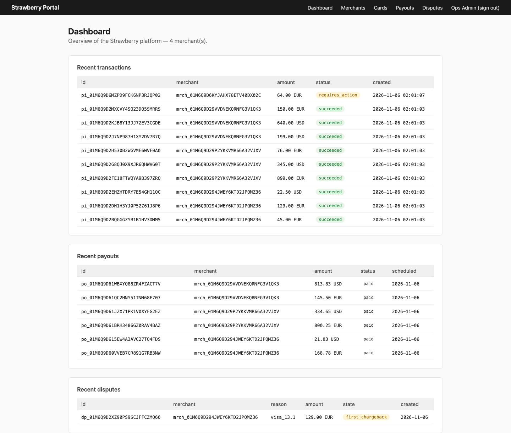
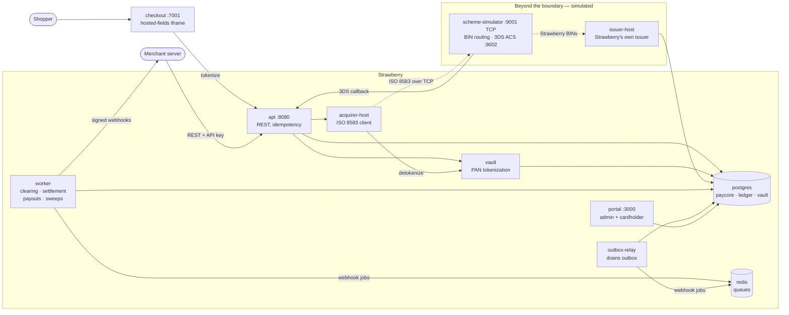
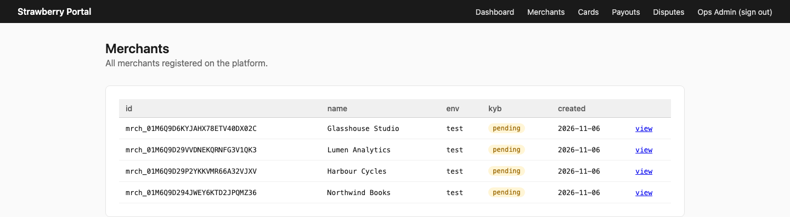
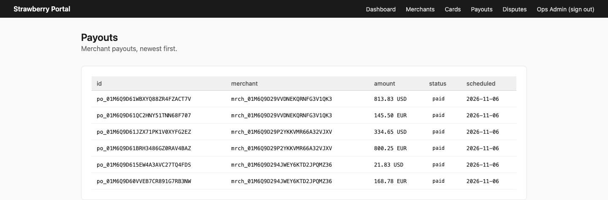
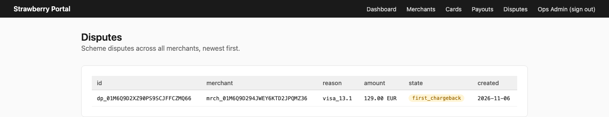
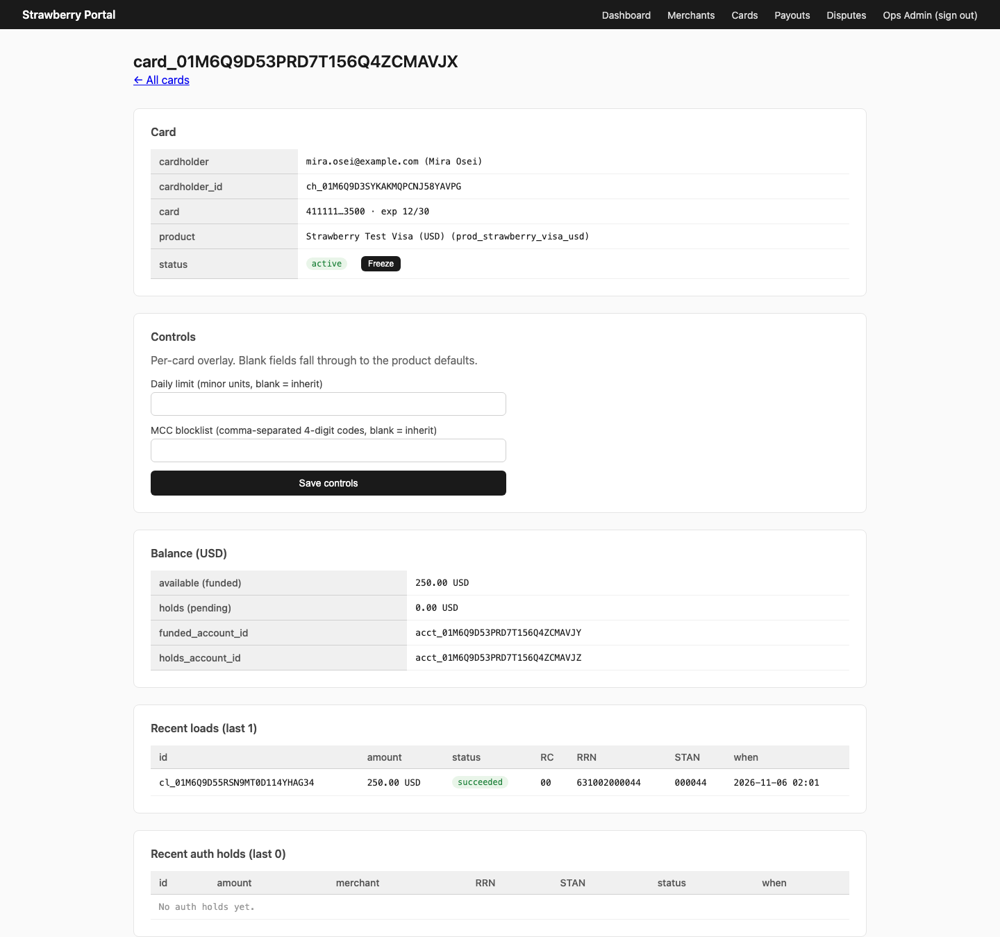
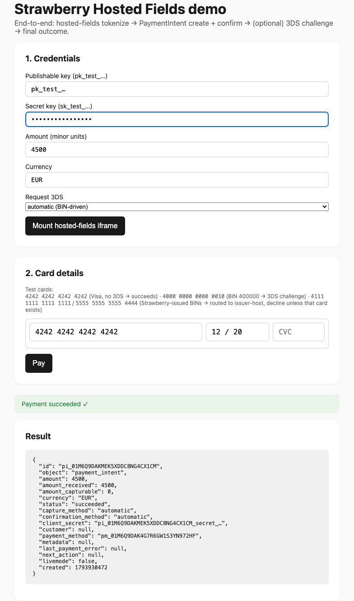
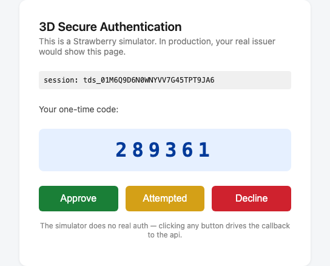
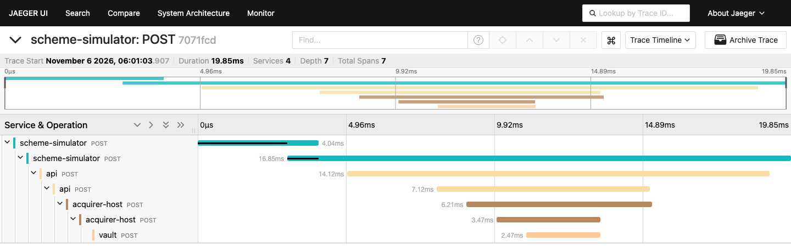

# psp-new — Payment Service Provider Simulator

A working card-payments platform you can run on a laptop: a merchant takes a
card payment, the authorisation crosses a real ISO 8583 wire to a simulated
card scheme, and the money lands in a double-entry ledger that is forced to
balance to zero.

## What this is, and what it isn't

- **A learning simulation.** No real money moves. There is no scheme
  membership, no payment-institution licence, no sponsor bank and no PCI
  certification. The card networks are replaced by a local simulator.
- **Everything inside that boundary is real code.** The ISO 8583 codec, the
  ledger, the tokenization vault, clearing files, settlement, payouts,
  webhooks and disputes are implemented, tested and running — not mocked.
- **Built with [Claude Code](https://claude.com/claude-code)**, over 50 numbered
  phases, each with a plan and a write-up committed alongside the code.
- **"Strawberry"** is the placeholder product name you'll see inside the app.



## Follow one payment

1. **The shopper types a card** into an iframe served from the PSP's own
   origin, so the merchant's page never touches the PAN
   ([`apps/checkout`](apps/checkout)).
2. **The vault tokenizes it.** It is the only service that ever sees a raw
   PAN — it has its own Postgres role, and the application role is denied
   access to its schema at the database level ([`apps/vault`](apps/vault),
   [migration 0011](packages/db/migrations/0011_vault_role_isolation.sql)).
3. **A PaymentIntent is created and confirmed.** A state machine decides
   whether 3-D Secure is needed; BIN 400000 gets a challenge page, rendered by
   the simulated issuer ([`packages/payment-engine`](packages/payment-engine),
   [`apps/scheme-simulator/src/three-ds.ts`](apps/scheme-simulator/src/three-ds.ts)).
4. **The authorisation goes over the wire.** The acquirer host builds an
   ISO 8583 `0100`, frames it with a 4-byte ASCII length header and sends it
   over TCP. The codec is written from scratch
   ([`apps/acquirer-host`](apps/acquirer-host), [`packages/iso8583`](packages/iso8583)).
5. **The scheme simulator routes by BIN.** Strawberry-issued ranges go to our
   own issuer, which applies spending controls against a per-card ledger;
   everything else hits the stub issuer's response-code table
   ([`apps/issuer-host`](apps/issuer-host), [`packages/issuing`](packages/issuing)).
6. **Capture and refund post journal entries** — always `BIGINT` minor units,
   always balancing per currency ([`packages/ledger`](packages/ledger)).
7. **A nightly job writes clearing files** — one per scheme and currency, in
   Visa Base II and Mastercard IPM shapes, carrying the real RRN from the
   authorisation ([`packages/clearing-files`](packages/clearing-files), [`apps/worker/src/clearing-job.ts`](apps/worker/src/clearing-job.ts)).
8. **Settlement drains the scheme receivable, then the merchant is paid out**
   net of fees and refunds
   ([`apps/worker/src/scheme-settlement-job.ts`](apps/worker/src/scheme-settlement-job.ts), [`packages/payouts`](packages/payouts)).
9. **The books are checked.** Every currency's journal lines must sum to
   exactly zero — the last step of `make e2e`.

## Architecture



## Screenshots

| | |
|---|---|
|  <br> **Merchants** — onboarded through the sign-up form, each with its own API keys. |  <br> **Payouts** — one per merchant and currency, netted and marked paid by the nightly run. |
|  <br> **Disputes** — scheme reason codes and a chargeback state machine. |  <br> **An issued card** — masked PAN, spending controls, per-card balance, and a load carrying its own RRN and STAN. |
|  <br> **Hosted-fields checkout** — the card is typed into an iframe; the merchant page only ever holds a token. |  <br> **The simulated ACS** — a 3-D Secure challenge, with the outcome carried back into the authorisation. |



One authorisation traced end to end across four services — the 3DS callback
into the api, the authorisation through the acquirer host, and the vault
detokenize that hands the PAN to the wire.

## What it covers

| Concept | Where it lives |
|---|---|
| Acquiring — auth `0100`/`0200`, capture `0220`, reversal `0420`, refund | [`packages/payment-engine`](packages/payment-engine), [`apps/acquirer-host`](apps/acquirer-host) |
| ISO 8583 codec (MTI, bitmaps, DEs, TCP framing) | [`packages/iso8583`](packages/iso8583) |
| Issuing — card products, PAN generation, spending controls | [`packages/issuing`](packages/issuing), [`apps/issuer-host`](apps/issuer-host) |
| Double-entry ledger, per-currency, append-only | [`packages/ledger`](packages/ledger) |
| Tokenization and PCI scope isolation | [`apps/vault`](apps/vault), [`packages/kms`](packages/kms) |
| Clearing files — Visa Base II and Mastercard IPM shapes | [`packages/clearing-files`](packages/clearing-files) |
| Settlement and file ingestion | [`apps/worker/src/scheme-settlement-job.ts`](apps/worker/src/scheme-settlement-job.ts), [`apps/api/cli/clearing-ingest.ts`](apps/api/cli/clearing-ingest.ts) |
| Reconciliation — file vs ledger, and the card-load pool | [`packages/clearing-files`](packages/clearing-files), [`apps/worker/src/pool-reconciliation-job.ts`](apps/worker/src/pool-reconciliation-job.ts) |
| Merchant payouts | [`packages/payouts`](packages/payouts) |
| 3-D Secure simulation | [`packages/payment-engine/src/three-ds.ts`](packages/payment-engine/src/three-ds.ts), [`apps/scheme-simulator/src/three-ds.ts`](apps/scheme-simulator/src/three-ds.ts) |
| Webhooks — signed, retried, dead-lettered | [`packages/webhook-delivery`](packages/webhook-delivery), [`apps/outbox-relay`](apps/outbox-relay) |
| Dispute lifecycle and scheme reason codes | [`packages/disputes`](packages/disputes) |
| Idempotency keys on the money-moving endpoints | [`packages/idempotency`](packages/idempotency) |

## Run it locally

Needs Docker Desktop, Node 22+ and pnpm 10 (corepack installs it).

```bash
pnpm install
cp .env.example .env
make up                        # or: make up-full, to add Grafana/Jaeger/Prometheus

set -a; source .env; set +a    # make migrate does not read .env itself
make migrate
make e2e                       # health smoke, then the payment canary
```

Then: [API :8080](http://localhost:8080/v1/healthz) · [portal :3000](http://localhost:3000) ·
[checkout demo :7001](http://localhost:7001/demo.html) · [3DS simulator :9002](http://localhost:9002).
With `make up-full`, also Grafana :3001, Jaeger :16686, Prometheus :9090.

To browse the portal you need an admin user and some data:

```bash
pnpm --filter @psp-new/portal user:create --email you@example.com --name "Ops" --password "<8+ chars>"
node ops/scripts/seed-demo.mjs          # 3 merchants, 9 payments, a refund, a dispute, an issued card
pnpm --filter @psp-new/worker nightly:once
```

### The canary

`make e2e` ends with a real payment driven through the running stack, which
asserts the books balance. On a fresh database:

```
e2e canary — full payment → ledger → clearing → settlement → payout
  ✓ api healthz — http://localhost:8080
  ✓ merchant fixture — mrch_01M6Q8XJC77G568AV1SR4P85WD
  ✓ vault tokenize — tok_01M6Q8XJDV0SKCWVFPCY54MJJK (visa …4242)
  ✓ payment_method — pm_01M6Q8XJEXJ7P6EP0F00T06YCB
  ✓ payment_intent — pi_01M6Q8XJFQV793F05AT4G0ZA42 succeeded, RRN 631001000002 STAN 000002
  ✓ refund — re_01M6Q8XJKJHR5MJ57XG8QNJ524 for 2500, amount_received now 7500
  ✓ nightly-once — clearing + payouts + scheme settlement ran
  ✓ clearing record — RRN 631001000002 in visa_usd_20261106_001.b2
  ✓ payout — po_01M6Q8XKBDNBQVA9WNT9GC61QJ paid 7275 = settlement liability
  ✓ scheme settlement — scheme_receivable USD drained to 0
  ✓ ledger zero-sum — USD all sum to 0
CANARY PASSED — 11 steps green
```

Re-running it the same day honestly reports the steps that daily idempotency
makes no-ops, rather than claiming them.

### Test cards

Verified against the running stack on 2026-11-06.

| PAN | Result |
|---|---|
| `4242 4242 4242 4242` | succeeds — use this one |
| `4000 0000 0000 0010` | `requires_action` → 3DS challenge at :9002, then succeeds |
| `4111 1111 1111 1111` | declines (DE 39 code 14) |
| `5555 5555 5555 4444` | declines (DE 39 code 14) |

The last two fall inside `STRAWBERRY_BIN_RANGES`, so the simulator routes them
to our own issuer rather than its stub — and it declines them unless such a
card has actually been issued ([`PHASE_9_DONE.md`](PHASE_9_DONE.md)).

### Operator CLIs

| Command | What it does |
|---|---|
| `pnpm merchant:create --name "Acme Inc."` | Merchant + `pk_test_`/`sk_test_` keys (printed once) |
| `pnpm cardholder:create` / `card:issue` / `card:load` | The issuing loop (PAN printed once at issue) |
| `pnpm ledger:balance <acct_…>` | Balance for one ledger account |
| `pnpm canary` | The full-payment canary against the running stack |
| `pnpm --filter @psp-new/worker nightly:once` | One synchronous nightly pass |
| `pnpm --filter @psp-new/api clearing:ingest --path <file>` | Ingest and reconcile a settlement file |

## Repo tour

| Path | What lives here |
|---|---|
| [`apps/api`](apps/api) | Public REST API — merchant and cardholder surfaces |
| [`apps/vault`](apps/vault) | Tokenization vault — the only service that sees a raw PAN |
| [`apps/acquirer-host`](apps/acquirer-host) | ISO 8583 client to the scheme simulator |
| [`apps/scheme-simulator`](apps/scheme-simulator) | ISO 8583 server, stub issuer, BIN routing, 3DS ACS |
| [`apps/issuer-host`](apps/issuer-host) | Strawberry's own issuer — controls + per-card ledger |
| [`apps/worker`](apps/worker) | Clearing, settlement, payouts, sweeps, webhook delivery |
| [`apps/outbox-relay`](apps/outbox-relay) | Drains the transactional outbox |
| [`apps/portal`](apps/portal) | Admin and cardholder portal (server-rendered) |
| [`apps/checkout`](apps/checkout) | Hosted-fields iframe origin |
| [`packages/`](packages) | 26 shared libraries |
| [`packages/db/migrations`](packages/db/migrations) | 34 numbered SQL migrations |

TypeScript throughout, Fastify, Postgres with Kysely, Redis and BullMQ,
OpenTelemetry. 35 workspace packages; `pnpm typecheck` and `pnpm test` each
run 60 tasks.

## How it was built

Work lands in numbered phases — a plan committed before the code, a write-up
after it, both at the repo root. 50 phases so far, 96 documents. A few worth
reading:

- [`PROJECT_BRIEF.md`](PROJECT_BRIEF.md) — the original spec
- [`PHASE_1_DONE.md`](PHASE_1_DONE.md) — the ledger, built before anything else
- [`PHASE_5_DONE.md`](PHASE_5_DONE.md) — ISO 8583 and the scheme simulator
- [`PHASE_42_DONE.md`](PHASE_42_DONE.md) — the canary, and the four latent bugs it found
- [`DECISIONS.md`](DECISIONS.md) · [`GLOSSARY.md`](GLOSSARY.md) · [`CLAUDE.md`](CLAUDE.md)

The newest `PHASE_*_DONE.md` carries the open list.

## Limitations

Deliberate, and worth stating plainly:

- The scheme leg is simulated. There is no connectivity to Visa, Mastercard
  or any real network, and nothing here is licensed or certified to handle
  real money or real cardholder data.
- Cancelling an uncaptured authorisation sends a real `0420` reversal, but a
  refund of a captured payment posts to the ledger only — nothing goes over
  the wire. MTI `0400`/`0410` and `0800`/`0810` exist in the codec's type
  union and are never sent.
- [`packages/risk-rules`](packages/risk-rules) is written and unit-tested but
  wired into nothing: no risk decision is recorded on an authorisation today.
- `merchants.payout_schedule` is ignored — payouts run daily. There are no
  reserves, and a dormant merchant with a residual balance is not picked up.
- The scheduled nightly job only ever looks at yesterday, so a day the
  worker was down for is not swept by any later run on its own —
  `nightly:once --date YYYY-MM-DD` has to be run for it.
- The portal has no detail pages for payouts or disputes, and no dispute
  actions.
- Dev-only security posture: open CORS, `frame-ancestors *`, an
  unauthenticated 3DS callback and a committed development KMS key. Fine for
  localhost, nowhere near fit for anything else.
- CI runs lint, typecheck, tests and the migrations. It does not run
  `make e2e` against compose; the browser test is opt-in.

## Licence

[MIT](LICENSE).
